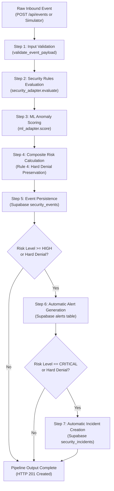

# AI Shield — Central Event Processing Pipeline

This document details the architecture, data flow, adapter interfaces, risk calculation logic, and teammate integration instructions for the AI Shield Central Event Processing Pipeline.

---

## 1. Pipeline Architecture

The event processing pipeline serves as the central nervous system of AI Shield. It unifies inbound telemetry from simulators/agents, evaluates security rules, incorporates machine learning anomaly scores, calculates composite risk, persists records in Supabase PostgreSQL, and triggers automatic alerts and incidents for high-severity events.



---

## 2. Processing Sequence

Each event flows through seven deterministic steps:

1. **Validation**: Checks JSON structure, actor types (`employee`, `agent`, `external`), required fields (`event_type`, `resource`, `action`, `source`, `is_sensitive`), and formats ISO timestamps.
2. **Deduplication Check**: Ensures `event_id` is unique in `security_events` (returns `409 Conflict` if duplicate).
3. **Security Rules Evaluation**: Evaluates hard rules (e.g., unauthorized external sharing, autonomous agent boundary violations, access control lists). Returns `rule_result`, `hard_denial`, and `recommended_action`.
4. **ML Anomaly Scoring**: Evaluates statistical deviation from baseline (e.g., unusual destinations, unexpected actors, anomalous timing). Returns `anomaly`, `risk_score` (0.0–100.0), and `risk_level`.
5. **Composite Risk Calculation**:
   - **Enforces `docs/api_contract.md` Rule 4**: *"ML provides an anomaly signal; it must never override a hard security denial."*
   - If `hard_denial == True`: Risk score is guaranteed &ge; `85.0`, and risk level is locked to `critical`.
   - If `hard_denial == False`: Combines baseline score and ML anomaly signals into configured thresholds:
     - `0.0 - 29.9` &rarr; `low`
     - `30.0 - 59.9` &rarr; `medium`
     - `60.0 - 79.9` &rarr; `high`
     - `80.0 - 100.0` &rarr; `critical`
6. **Persistence**: Saves the enriched record into Supabase PostgreSQL `security_events`.
7. **Incident & Alert Generation**:
   - **High & Critical Risk**: Automatically creates an alert in the `alerts` table.
   - **Critical Violations & Hard Denials**: Automatically creates an incident in the `security_incidents` table.
   - **Deduplication**: Queries existing alerts/incidents before inserting to guarantee no duplicates for the same `event_id`.

---

## 3. Expected Inputs & Outputs

### Input Payload (`POST /api/events`)
Conforms strictly to `docs/api_contract.md`:
```json
{
  "event_id": "EVT101",
  "event_type": "file_share",
  "actor_type": "employee",
  "actor_id": "EMP002",
  "resource": "customer_records.csv",
  "is_sensitive": true,
  "action": "share",
  "destination": "personal_dropbox",
  "source": "employee_simulator",
  "description": "Attempted file transfer to external cloud storage"
}
```

### Pipeline Output (HTTP 201 Created)
```json
{
  "success": true,
  "message": "Security event registered successfully",
  "meta": {
    "alert_id": "ALT-75BBC3A1",
    "incident_id": "INC-54236AFA",
    "risk_level": "critical",
    "risk_score": 85.0
  },
  "data": {
    "id": 12,
    "event_id": "EVT101",
    "event_type": "file_share",
    "actor_type": "employee",
    "actor_id": "EMP002",
    "resource": "customer_records.csv",
    "is_sensitive": true,
    "action": "share",
    "destination": "personal_dropbox",
    "timestamp": "2026-11-04T18:30:00Z",
    "source": "employee_simulator",
    "description": "Attempted file transfer to external cloud storage",
    "rule_result": "flagged_dlp_external_share",
    "anomaly": true,
    "risk_score": 85.0,
    "risk_level": "critical",
    "recommended_action": "quarantine_attachment_and_notify_manager",
    "created_at": "2026-11-04T18:30:00Z"
  }
}
```

---

## 4. How Teammate Modules Connect

To prevent duplicate database connections and keep business logic isolated, teammate modules operate as pure functional evaluators.

### A. Connecting the Security Rules Engine (`security/`)

Teammates implementing security policies and DLP rules should expose an evaluation function or class matching this interface:

```python
# security/rule_engine.py
from backend.pipeline.security_adapter import SecurityRuleResult

class ProductionSecurityRuleEngine:
    def evaluate(self, event: dict) -> SecurityRuleResult:
        # Custom DLP / ACL evaluation logic
        is_external = event.get("destination") not in ("internal", "local", "")
        if event.get("is_sensitive") and is_external:
            return SecurityRuleResult(
                rule_result="flagged_dlp_external_share",
                hard_denial=True,
                recommended_action="quarantine_attachment_and_notify_manager",
                rule_violations=["DLP-001: External share prohibited"]
            )
        return SecurityRuleResult(rule_result="allowed", hard_denial=False, recommended_action="none")
```

**To plug in the teammate security engine**, register it in `backend/app.py` or entry point:
```python
from backend.pipeline import set_security_adapter
from security.rule_engine import ProductionSecurityRuleEngine

set_security_adapter(ProductionSecurityRuleEngine())
```

---

### B. Connecting the Machine Learning Module (`ml/`)

Teammates implementing anomaly detection (e.g. Scikit-Learn IsolationForest in `ml/model/*.pkl`) should expose an evaluation function matching:

```python
# ml/anomaly_detector.py
from backend.pipeline.ml_adapter import MLAnomalyResult

class ProductionMLAnomalyDetector:
    def __init__(self):
        # Load trained model artifact
        # self.model = joblib.load("ml/model/isolation_forest.pkl")
        pass

    def score(self, event: dict) -> MLAnomalyResult:
        # Extract features and predict
        # score = calculate_anomaly_score(event)
        return MLAnomalyResult(
            anomaly=True,
            risk_score=78.5,
            risk_level="high",
            confidence=0.92,
            factors=["Anomalous destination", "Off-hours access"]
        )
```

**To plug in the teammate ML detector**:
```python
from backend.pipeline import set_ml_adapter
from ml.anomaly_detector import ProductionMLAnomalyDetector

set_ml_adapter(ProductionMLAnomalyDetector())
```

---

## 5. Distinction Between Detection and Real-World Enforcement

Per `docs/api_contract.md` Rule 5:
> *Simulated actions must not be described as real-world monitoring or blocking.*

- The platform produces **recommendations**, **flags**, and **alerts** (e.g., `"quarantine_attachment_and_notify_manager"`).
- Alert messages and incident summaries are explicitly prefixed with `"Simulated event..."` to ensure clarity during demonstrations and audits.

---

## 6. Testing the Pipeline

Run the automated pipeline test suite:
```bash
python -m unittest backend/tests/test_pipeline.py -v
```

Run all backend tests together:
```bash
python -m unittest discover -s backend/tests -v
```
