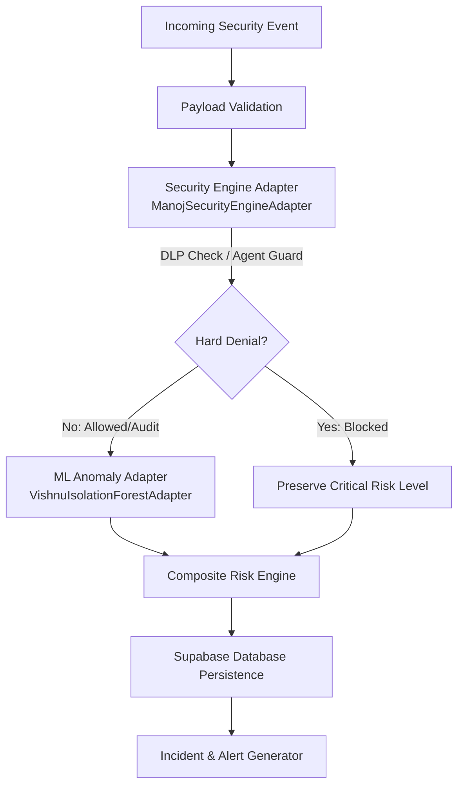

# AI Shield — Security Module Integration Guide

This guide documents the integration of Manoj's Security Module (`security/`) into the AI-SHIELD system.

---

## 1. Architectural Overview

AI-SHIELD employs a modular, defense-in-depth pipeline where **deterministic security rules execute before statistical machine learning anomaly detection**.



### The Hard Denial Preservation Principle (Rule 4)
As stipulated in `docs/api_contract.md`:
> *"ML provides an anomaly signal; it must never override a hard security denial."*

When Manoj's security module triggers a hard denial (such as an unauthorized AI agent accessing payroll files or a DLP violation transferring sensitive data externally), the composite risk score is clamped to **$\ge 85.0$** and severity is locked to **CRITICAL**, regardless of whether the ML model scores the access pattern as statistically normal.

---

## 2. Integrated Security Components

The integrated security engine is organized in the `security/` package:

| Component | File | Responsibilities |
|---|---|---|
| **Agent Guard** | `security/agent_guard.py` | Restricts autonomous AI agents against `AGENT_REGISTRY` permissions (allowed files, actions, destinations). Detects path traversal. |
| **DLP Engine** | `security/dlp_engine.py` | Evaluates file transfers against `BLOCKED_DESTINATIONS` (`personal_email`, `public_link`, `external_app`, `unknown`). Triggers automated file quarantine. |
| **Data Classifier** | `security/data_classifier.py` | Scans text and CSV files for PII (PAN, Aadhaar, Indian phone, email) and sensitive keywords (`salary`, `customer records`, `financial details`, etc.). |
| **Quarantine Manager** | `security/quarantine_manager.py` | Isolates restricted files from `test_data/` to `quarantine/` with unique IDs (`QTN-...`), updates `quarantine_log.json`, and supports audited release. |
| **Violation Tracker** | `security/violation_tracker.py` | Tracks per-agent violation histories in memory. Auto-suspends rogue agents after $\ge 3$ violations. |
| **Incident Analyzer** | `security/incident_analyzer.py` | Generates structured incident explanations, risk severity levels, and actionable analyst recommendations. |
| **Security Service** | `security/security_service.py` | High-level facade providing convenience functions (`check_agent_access`, `check_file_transfer`, `investigate_security_event`). |

---

## 3. Pipeline Adapter Interface

`backend/pipeline/security_adapter.py` exposes:

### `SecurityRuleResult`
```python
class SecurityRuleResult:
    rule_result: str          # "allowed", "allowed_with_audit", "flagged_dlp_external_share", "flagged_unauthorized_agent_access"
    hard_denial: bool         # True if policy forbids the operation
    recommended_action: str   # "revoke_agent_token_and_isolate", "quarantine_attachment_and_notify_manager", etc.
    rule_violations: list     # List of specific policy violation strings
    incident_analysis: dict   # Deep breakdown from incident_analyzer
```

### `ManojSecurityEngineAdapter`
Wraps the security submodules into the central pipeline contract:
- Validates agent requests against `process_agent_request` with auto-suspension.
- Validates external transfers against `evaluate_file_transfer` and `BLOCKED_DESTINATIONS`.
- Detects PII and sensitive markers using `is_sensitive_file` and regex scanning.
- Attaches contextual incident explanations via `analyze_incident`.

---

## 4. Verification and Testing

### 1. Security Pytest Suite (Manoj's native tests)
```bash
pytest security/
# Result: 14 passed
```

### 2. Security Integration Suite
```bash
python -m unittest backend.tests.test_security_integration
# Result: 9 passed
```

### 3. Full Backend Verification Suite
```bash
python -m unittest discover -s backend/tests -p "test_*.py"
# Result: 52 passed (35 Core API + 8 ML Integration + 9 Security Integration)
```

### 4. Frontend Production Build Check
```powershell
cd frontend
npm.cmd run build
# Result: tsc -b && vite build completed with 0 errors
```
